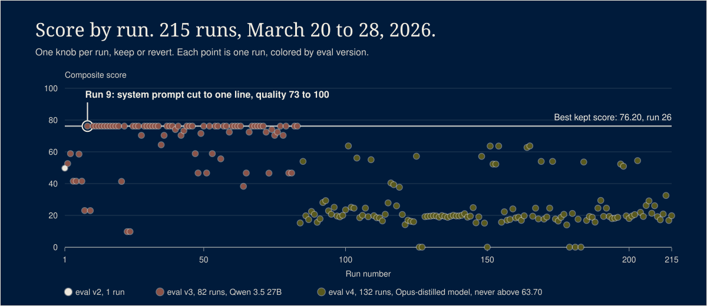
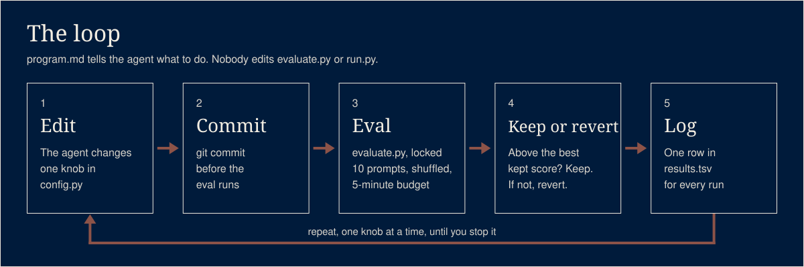

# autoresearch-mac-mini

In March 2026 I pointed Karpathy's autoresearch loop at the inference settings of a Qwen model on a
64 GB Mac Mini and let an agent run it overnight. One knob per experiment, a five-minute eval, keep
or revert. It logged 215 runs and wrote up 119 of them. The best change it found was cutting my system prompt
down to one line.
The eval is small and it saturates, so read this as a field note from one machine, not a benchmark.

## What it does



An agent tunes the Ollama inference settings of a local model, one change at a time, while you
sleep. Each experiment edits one knob in `config.py`, builds an Ollama model from it, runs a
fixed set of prompts under a five-minute budget, and scores the result. A better score keeps the
commit. An equal or worse score reverts it.

The setup it ran on:

- Apple Mac Mini, M4 Pro, 64 GB unified memory, Ollama 0.18.2.
- Model: the first 83 runs used Qwen 3.5 27B (`qwen3.5:27b`, Q4_K_M, 17 GB of weights), one on
  eval v2 and then 82 on eval v3. Every run after that used an Opus-distilled Qwen3.5-27B GGUF
  (the `MODEL_BASE` in `config.py`) on eval v4.
- Dates: March 20 to 28, 2026. `RESULTS.md` tables the first 119 experiments, through March 27.
  The loop kept going: `results.tsv` holds all 215 runs. The 96 runs after the table, all on the
  Opus-distilled model, never scored above 63.70.

### What the run found

- **The best change was the system prompt.** The best score before it was 58.85, from run 3.
  Run 9 cut the system prompt to one line, "You are a helpful assistant.", and quality went from
  73 to 100 of 100. Run 20 removed the system prompt entirely and scored the same.
- **The eval saturates.** From run 9 on, 45 of those 82 eval-v3 runs scored 76.19 or 76.20:
  quality pinned at 100, speed at 9.5 or 9.6 tokens per second. Once every answer is right, the
  only thing left to separate two configs is speed noise, so keep or revert became a coin flip.
- **System prompts that told the model how to answer made it worse.** "Think briefly, then
  answer" scored 23.02 and adding "Be concise." scored 23.01, both with quality 18.

## Run it

You need macOS or Linux, Python 3.12 (the version CI tests), [Ollama](https://ollama.com) running on
`localhost:11434`, the model in `config.py` pulled, and a git repo for the loop to commit into.

```bash
python3 -m venv .venv
.venv/bin/pip install -r requirements-dev.txt

# Start your own log: move the shipped one aside first.
mv results.tsv results-2026-03.tsv

.venv/bin/python3 run.py --baseline   # record the score to beat
.venv/bin/python3 run.py              # one experiment
.venv/bin/python3 run.py --loop       # forever, until Ctrl+C
```

`program.md` is the prompt for the experiment agent: read the config and the log, change one
thing, commit, run the eval, keep or revert. It tells the agent never to touch `evaluate.py`.

## Test it

[](https://github.com/jaysueno/autoresearch-mac-mini/actions/workflows/ci.yml)

```bash
python3 -m venv .venv
.venv/bin/pip install -r requirements-dev.txt
.venv/bin/python -m pytest
```

The tests need no model and no Ollama. They cover the eval's scoring functions (code is
executed and checked, reasoning penalizes the common wrong answer, thinking earns a bonus on hard
problems), the keep-or-revert bookkeeping in `run.py`, the constraints `program.md` puts on
`config.py`, and the numbers this README quotes, read from `RESULTS.md`.

## How it works



```
  program.md (the agent's instructions)
        |
        v
  agent edits ONE knob in config.py ---> git commit
        |
        v
  evaluate.py (locked)
    config.py -> Modelfile -> ollama create
    10 prompts, shuffled, 5-minute budget
    quality: code run against test cases, answers checked
    composite = quality * 0.65 + tok/s * 0.20 + memory * 0.15
        |
        v
  run.py: composite > best kept score?
        |                         |
       yes: keep the commit      no: revert, log it
        |                         |
        +-------- results.tsv <---+
                      |
                    repeat
```

| File | Role | Who edits it |
|---|---|---|
| `config.py` | The knobs: context, batch, threads, sampling, thinking mode, system prompt | The agent |
| `evaluate.py` | The locked eval: prompts, scorers, the composite score | Nobody |
| `run.py` | Runs the eval, compares to the best kept score, logs the result | Nobody |
| `program.md` | The agent's instructions and constraints | A human |
| `results.tsv` | Every run, 215 rows, with model, eval version and sampling settings | The loop |
| `results_full.tsv` | The first 119 runs, the same rows `RESULTS.md` tables | The loop |
| `RESULTS.md` | The first 119 experiments as one table | Generated from the log |
| `notebook.ipynb` | Charts of score, speed and quality over the run | A human |

The `evaluate.py` here is v4: ten prompts in a shuffled order, the version behind every
Opus-distilled run. The 82 runs on eval v3 used an earlier, eight-prompt version of the file that is not part
of this repo.

`run.py` and `notebook.ipynb` read the 11-column format `run.py` writes (it has a `status`
column for keep, discard or crash). The shipped `results.tsv` is the wider log, which is why you
move it aside before your own baseline.

## What it will not do

- It speaks for one machine, one model family and a small eval that hits its ceiling, nothing wider.
- It does not search more than one knob at a time, and it cannot see interactions between knobs.
- It does not change the model, the context window (`NUM_CTX` stays 32768) or thinking mode for
  code and reasoning prompts. `program.md` forbids it.
- It does not stop on its own. `--loop` runs until you stop it.
- `program.md` tells the agent to push after every keep or revert. Point it at a repo of your
  own, or delete that step.

## License

MIT. See [LICENSE](LICENSE). The loop is inspired by
[karpathy/autoresearch](https://github.com/karpathy/autoresearch).
